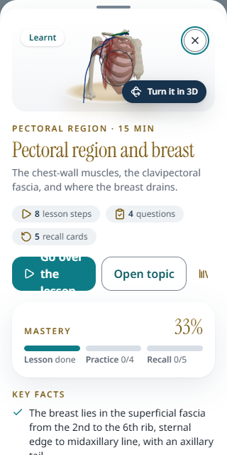
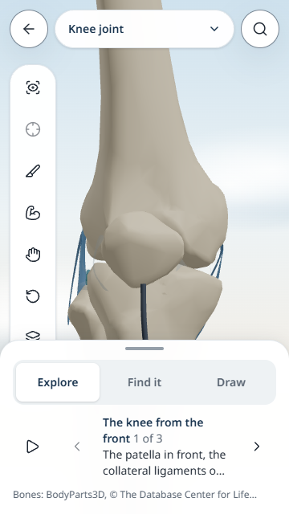

# MedLearn OS source and UI review

Reviewed on 16 October 2026. The app is substantially closer to the planned single study system. Keep the current visual direction and shared learning loop; prioritize reliable progress, current review decisions, phone usability and a small reviewed pilot before another broad feature expansion.

## Snapshot and copy

- Source: `D:\Dev Workspace\MedLearn-OS`, branch `reviewer-app`, commit `f381ae71a0b6014290a98a1bdfbd86ae89919584`.
- Destination: `D:\Dev Workspace\MedLearn-OS-Codex`, branch `codex/october-sync-review`.
- The older `D:\Dev Workspace\MeLearn-OS-Codex` checkout was preserved. The source checkout was read only during this review.
- A fresh independent clone retains the source history. Robocopy overlaid the working files, including the two uncommitted October planning documents. No mirror/purge deletion was used.
- Copy exclusions: Git metadata, dependencies, build/test output, environment secrets, raw textbook/model sources and local tool settings. Tracked repository settings remain available from the clone.
- Robocopy reported no failures. SHA-256 comparison matched all 761 included source files. The copied uncommitted documents are `MedLearn_OS_Content_Plan_Physiology_Biochemistry_v0_1.docx` and `MedLearn_OS_Scan_Security_Gaps_UI_2026-10-16.docx`.

## What has changed since September

The catalogue now has **119 topics: 118 anatomy topics and the oxygen–haemoglobin curve**, spanning Upper Limb, Thorax, Lower Limb and Abdomen. These are bundled sample records; live approval outcomes depend on the review database. The old README count of 31 and September review count of 16 were no longer current.

Today now combines the next study action, exam phases, catch-up limits, class-test goals, spaced topic revisits and daily activity. The Library organizes topics by subject, region and book section with previews and live search. Topic study adds lecture playback and timestamped notes. The profile edits the student's plan and books.

The shared Studio now includes a whole body with system layers, searchable structures, isolation, sections, joint movement, X-rays, topic models, tours, quizzes and drawing. This is a strong foundation for one app; separate anatomy tools do not need to become separate products.

The new reviewer app implements a work queue, versioned approval/change decisions, four checks, history and student-report triage. Earlier scan text saying this workflow is missing is superseded by the current code. The next milestone is to harden it, appoint accountable reviewers and actually review a bounded set of content.

## Highest-priority engineering recommendations

| Priority | Finding and evidence | Recommended change and acceptance check |
| --- | --- | --- |
| P1 | **Synced deletions return.** `removeGoal` deletes locally, while `mergeProgress` unions the account goal back. Completing the final revisit removes it locally, but `mergeRevisits` restores the account record. Both behaviors were reproduced using the actual production exports. See `apps/web/src/features/progress/store.ts:124` and `:187`, and `packages/core/src/merge.ts:16` and `:49`. | Add deletion/completion tombstones or per-entity revisions, including legacy migration and bounded cleanup. Delete an already-synced goal and complete a final revisit; sync, reload and use a second device. Neither should return. |
| P1 | **Review decisions stay stale in an open app.** `features/review/state.ts:26` retains the first status promise for the browser module lifetime. Client navigation does not start a new page load. | Refresh with a short TTL/on focus and invalidate after decisions. Keep the UI's pending/offline state honest. Change approved to changes requested while a student tab stays open and verify it updates. |
| P1 | **Review audit fields can be forged by an authorized reviewer.** The database insert policy checks `reviewer_id`, but `reviewer_email` and `created_at` have defaults rather than enforced server values. A direct Supabase insert can supply them. See `supabase/migrations/20261016120000_topic_reviews.sql:47` and `:71`. | Derive identity and time in a database trigger or restrict column writes. Add a pgTAP case attempting another email/future timestamp. This finding concerns reviewer accounts; it is not evidence of anonymous write access. |
| P1 before publishing reviewed content | **Approval depends on manually maintained semver.** `reviewState` and the reviews API compare `contentVersion`; changing content or an asset without a version bump can retain approval. | Generate an immutable content/review manifest or digest, and make CI require a new version when reviewed facts, answers, labels or assets change. Record reviewer qualification separately from the email allowlist. |
| P2 | **Search failures are swallowed.** `features/search/LiveSearch.tsx:113` does not check HTTP status and catches network errors without updating state. `features/studio/BodyPanels.tsx:25` follows the same pattern. | Separate loading, error and true-empty states. Offer retry and an offline hint; cancel stale work. An aborted/500 request must not leave a permanent spinner or imply no matching content exists. |
| P2 | **Content delivery needs another scaling pass.** Practice still receives all questions and the tree even for a topic-scoped session; global Revise receives the whole deck. See `app/(study)/practice/page.tsx:30` and `app/(study)/revise/page.tsx:23`. | Deliver session-sized question/card sets and lazy-load expanded catalogue branches. Measure HTML/RSC bytes and interaction time before adding the next subjects. Keep search and subject metadata separate from full teaching content. |
| P2 | **Offline asset management is manual.** Existing GLB/index query versions were checked against history and were bumped with rebuilt assets; no concrete stale-model/version mismatch was found. `public/sw.js` retains old `files-v1` entries and excludes posters/X-rays. | Automate hashes/version checks, expire obsolete cached files and define intentional offline lesson packs. Test an installed-app upgrade and offline images/3D. Do not describe the existing model cache as a confirmed stale-asset bug. |

## UI recommendations

Preserve Calm Sky, the teal primary actions, the existing navigation and one dominant task on Today. The next UI cycle should improve hierarchy and predictable interaction rather than change the theme again.

1. **Make Studio usable on short phones.** This is confirmed at **360 × 640** on the knee topic: the bottom sheet covers the Settings button, and a normal browser click times out. The tool column runs from y=80 to y=502 while Settings occupies y=449–497. Keep frequent actions visible and put advanced tools in a compact More sheet or a capped scrollable toolbar. Preserve 48-pixel tap targets and check landscape too.
2. **Let reviewers inspect visual evidence.** `features/review/TopicSheet.tsx` lists diagram labels and 3D descriptions as text, while `ReviewForm.tsx` asks reviewers to certify those visuals. Add direct Open lesson, Open diagram and Open 3D actions tied to the reviewed version. On phones, place the evidence before the decision form or make the decision action sticky without covering it.
3. **Give task changes predictable focus.** After a question, recall rating or lecture selection, move focus to the new prompt/heading and announce progress. Phone Studio sheets need dialog semantics, Escape/back behavior and focus return; their current plain sections do not provide those behaviors.
4. **Fix narrow Library layouts.** This is confirmed at **320 × 640**: the learnt-topic preview's “Go over the lesson” label wraps to three lines and is clipped inside its fixed-height button. The action row places two full-width buttons and the reading control in one nonwrapping row (`TopicPreview.tsx:133`). Stack actions on narrow screens and move metadata below long titles where necessary; verify enlarged text too.
5. **Use folding to reduce work as well as visual length.** Mount detailed rows/preview content when opened, keep the current chapter context, and make horizontal subject-chip scrolling discoverable. Group practice choices by region and bring weak sections forward.

| Library at 320 px | Knee Studio at 360 × 640 |
| --- | --- |
|  |  |

The controlled network-failure check also confirmed that an aborted search request leaves “Searching…” visible with no retry action. These screenshots and checks used synthetic student progress and empty mocked review outcomes, not real student or reviewer accounts.

## Content delivery measurement

The following are production HTML sizes from the local copied app, rounded to KiB. The gzip column is a local gzip of the HTML, not a measurement of the complete page download or first-load JavaScript.

| Route | HTML KiB | Gzipped HTML KiB |
| --- | ---: | ---: |
| `/today` | 102 | 24 |
| `/subjects` | 389 | 58 |
| `/practice` | 556 | 89 |
| `/practice?topic=brachial-plexus` | 556 | 89 |
| `/revise` | 536 | 97 |
| `/revise?topic=brachial-plexus` | 23 | 6 |

Topic-specific Revise already demonstrates the benefit of filtering on the server. Apply the same idea to Practice, while retaining an explicit way to choose another session. Global session delivery and catalogue hydration should be measured on the pilot phones before adding more content.

## Updated plan and recommended build order

The Product Blueprint v0.7, Engineering Plan v0.6, Profile Plan and both October documents were read as requirements text. Older scan counts and the claim that no reviewer flow exists do not describe this snapshot. The new content plan supersedes its proposed order: rotate **Anatomy → Physiology → Biochemistry**, roughly seven topics per batch, once the group's books/editions and reviewers are ready. Use curves, pathways and loops for Physiology/Biochemistry; require 3D only where it helps.

1. Fix synced deletions, review freshness/audit identity, search recovery and confirmed short-phone defects. Keep this a focused reliability/UI branch.
2. Review a small end-to-end content set with qualified reviewers. Exercise approval, change requests, content updates, reports and revocation. Peer proofreading must remain distinct from medical approval.
3. Run the private five-person pilot with deliberate access settings, production email/recovery, backups and actual phones. Collect observations before revising Today or navigation again.
4. Expand the three subjects in the agreed rotation. Add stable source IDs and edition/page evidence to facts, questions and assets, so content can be checked and replaced independently.
5. Extend the knowledge-map connections and structured reading guidance. Body browsing, book references and the hierarchy are useful foundations; they do not yet constitute a cross-subject map or a personalized reading prescription.
6. Trial a grounded topic assistant after reviewed content and pilot operations are stable. Start with sourced explanations and measured outcomes before an agent that changes plans or progress.

The remaining group decisions are pilot hosting/account ownership, invited users, the selected book editions, accountable reviewers and any college-specific teaching order. These are operational/product decisions, not reasons to replace the current architecture.

## Verification and limits

- Copy integrity: 761 included files matched by SHA-256; source snapshot and its uncommitted planning documents were preserved.
- Lint: passed.
- Unit/component tests: **602 passed across 104 files**.
- Full workspace typecheck: passed.
- Production build: passed; **391 static pages generated**.
- A small executable reproduction confirmed both deleted-goal and final-revisit resurrection. It is diagnostic evidence of existing bugs, not a claim those bugs were fixed in this review.
- Production browser inspection: desktop Today/Library, narrow Library preview, short-phone knee Studio, and a controlled search network failure. The desktop Today automated accessibility scan reported no violations; this is one screen, not a complete accessibility audit.
- Runtime browser measurements confirmed the two layout defects, the search failure state and the response sizes above. The final focused inspection reported no page-script errors.
- Model-version history was checked before retaining the offline-cache recommendation. Current manual query-version changes protect the rebuilt assets inspected.
- Secrets and environment files were not copied. Database migrations, authenticated reviewer actions, integration tests and deployment were **not** exercised against a live database in this review. No full browser matrix or new Lighthouse performance run was performed.

Local diagnostic logs, reproduction scripts and additional screenshots are retained in the ignored `test-results/codex-review-2026-10-16/` folder. The two UI evidence screenshots above are included with this report. Apart from the synchronized source snapshot, this branch's additions are planning/review documents, screenshots and the corrected README summary; the reported application defects remain proposed work.

This review does not certify medical accuracy, reviewer qualifications, asset rights, production deployment or low-end-phone WebGL performance. No source-folder code, database migration or deployed service was modified.
