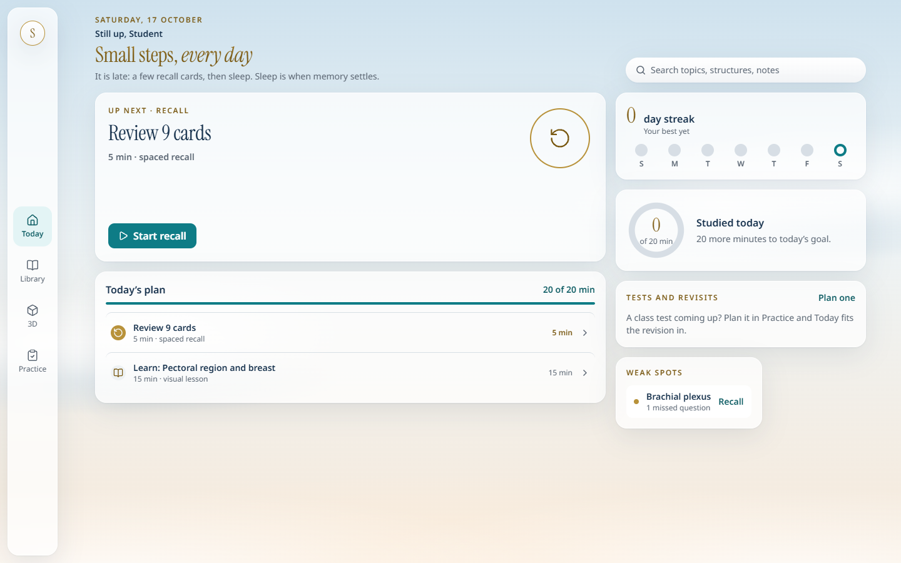
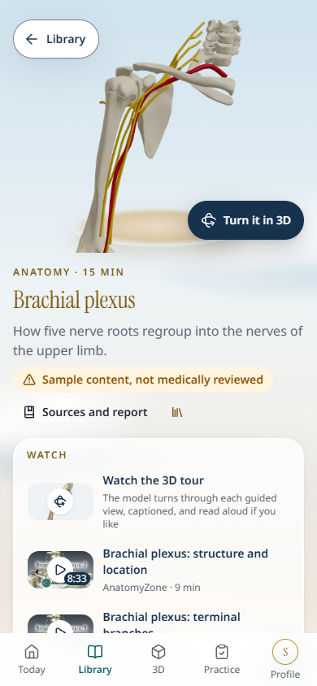
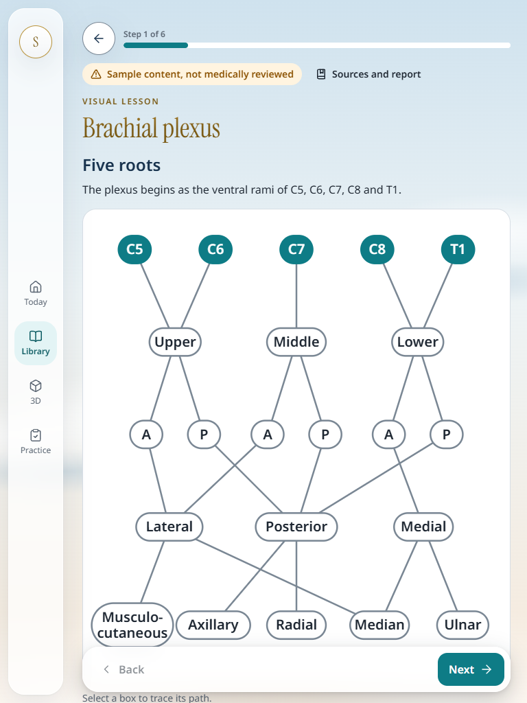
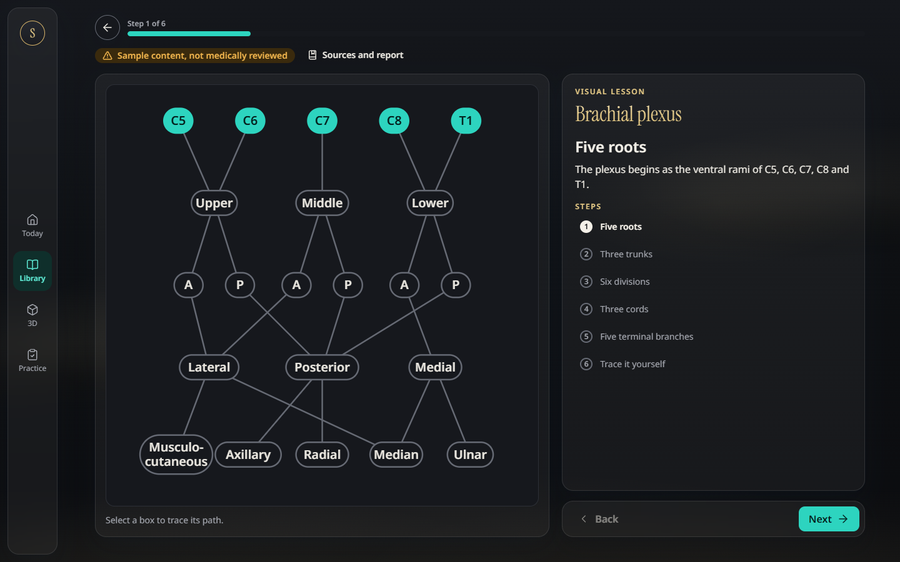
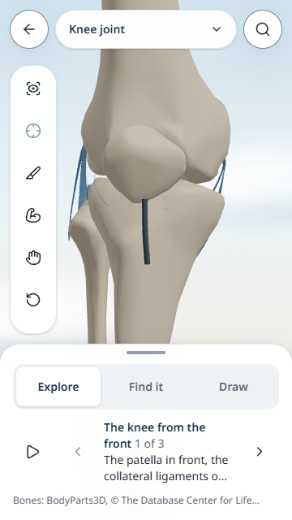

# MedLearn OS: focused study and Calm Sky UI review

17 October 2026. This review uses the user's five CRED reference images as a visual direction: a sky blue to warm cream backdrop, soft clouds, subtle glass, restrained gold, serif display titles and one clear action. Keep the MedLearn identity and teaching workflow; use the references to refine hierarchy, spacing and materials.

**Status:** source review and production-browser inspection are complete for the recorded build. The capture covered **46 states across six viewports**, including four night-theme states and two fresh-student states. The strongest next steps are to expose the lesson action sooner, distinguish planned time from completed study, and preserve a clear resume context. The combined implementation checks are tracked separately on PR #68.

## Git baseline and CI scope

| Item | Evidence / status |
| --- | --- |
| Remote `main` baseline checked | `09ceb91`, including merged PRs #63, #64 and #65 and the preceding content batch. |
| Latest source checkout checked | `D:\Dev Workspace\MedLearn-OS`, commit `dcea718` on `pelvis-batch-1`, associated with [PR #67](https://github.com/rakshithananda18-cmyk/MedLearn-OS/pull/67). |
| Source used for this design audit | Components and `docs/claude-memory/design-direction-calm-sky.md` read through `git show origin/pelvis-batch-1`. Findings cite those source locations; line numbers may move during reconciliation. |
| Codex review checkout | `D:\Dev Workspace\MedLearn-OS-Codex`, `codex/reliability-ui-fixes`. The latest source has been integrated here; the catalogue now contains **132 topics**. |
| PR #67 CI | All **six** checks were green when checked during this review. This validates that PR's checked revision. |
| Runtime build | `186d833`, with subsequent README/manifest formatting only; production build generated **431 static pages**. |
| Combined Codex PR | [PR #68](https://github.com/rakshithananda18-cmyk/MedLearn-OS/pull/68), attached to this task. Its [live checks](https://github.com/rakshithananda18-cmyk/MedLearn-OS/pull/68/checks) validate the combined implementation separately from the source PR. |

This report concerns the student experience. The teaching catalogue and review-team workflow are separate from a determination of medical accuracy or reviewer qualifications.

## Keep these strengths

- **One study system.** Today, Library, lessons, recall, practice, notes and the shared 3D Studio already connect around the same topics and progress. Keep these connections rather than adding another navigation layer.
- **A recognizable visual direction.** The sky/cream gradients, teal primary actions, Instrument Serif display titles, glossy pills and models on pedestals already implement Calm Sky. A new palette or wholesale theme replacement would discard useful consistency.
- **A clear starting concept.** Today's Up Next card and the Library's Continue row give students an entry point. Make those actions more prominent before adding more dashboard information.
- **Responsive foundations.** The app already supports a phone tab bar, a tablet/laptop rail, topic previews and two-pane study layouts. The custom breakpoints are **600 px (`md`), 840 px (`lg`) and 1024 px (`xl`)**; `xl` does not mean Tailwind's default 1280 px here.
- **Readable defaults and accessible foundations.** Body typography is 16 px with 1.5 line height; semantic colors, visible focus, reduced-motion handling and labelled controls are present in the source. Six targeted axe scans of Today and lesson screens reported no serious or critical findings.
- **The desktop lesson and night theme already work visually.** The inspected desktop lesson is clean and close to the reference direction. The night lesson remains quiet and readable, with restrained champagne/teal accents. Preserve these compositions while improving the compact layouts.

## Prioritized recommendations

### 1. Make the next study action the first decision

**Priority: P1.** Returning students should see what to do next before choosing among setup, lectures, tours or notes. The visual hero should support that decision.

**Verified in source:** `features/today/TodayView.tsx:256–285` places setup, catch-up and book prompts before Up Next. `features/topic/TopicStudy.tsx:299–310` places the lecture/tour block before the study actions. The topic poster precedes the content column on stacked layouts (`TopicStudy.tsx:316–320`); its minimum hero height is 15 rem (`packages/ui/src/styles/tokens.css:471–474`). These facts establish order and sizing rules, not the exact position of the action in a browser.

**Confirmed at runtime:** at **390 × 844**, the topic hub's Start lesson action spans approximately **y=843–913**, beyond the first usable viewport and under the bottom navigation. In tablet portrait its top is approximately **y=912**. The phone composition spends the initial screen on the model, title and alternatives before the main lesson action. The completed-topic state also still says **Start lesson** while the mastery card says the lesson is done; the Library correctly uses **Go over the lesson**.

**Recommended change:** keep one Start/Continue action directly below the topic or current task title. On a first visit, make required setup a single clear action; on return visits, place optional book/setup reminders after the next task. Fold alternative recordings, tours and notes until selected. Retain the larger model scene alongside the task where there is enough space.

**Acceptance:**

- At 360 × 640, a returning student can identify the next topic, session size and primary action without searching through secondary options.
- A topic opened from Today offers Start/Continue before its list of lecture choices.
- Use **Continue lesson** for an interrupted lesson and **Go over the lesson** for a completed one, consistently across Today, the topic hub and Library.
- On tablets and laptops, the model and title support one primary action; multiple equally prominent start buttons do not compete.
- Required account or age-related steps remain explicit; this recommendation changes presentation, not the conditions for saving data.

### 2. Make planned time distinct from completed study

**Priority: P1.** A full progress bar should not suggest that a student has finished the day's work when it describes the plan's estimated workload.

**Confirmed at runtime:** Today shows a full **20 of 20 min** plan bar alongside **0 studied today**. These values describe different things; the issue is their presentation, not evidence that completed minutes were incorrectly recorded. The plan bar uses planned minutes (`features/today/parts.tsx`, `PlanCard`), while the study-time display uses the recorded daily activity.

**Recommended change:** label the estimate explicitly as **20 min planned** and the activity as **0 min studied**. If the bar represents completion, fill it from completed activity; show remaining planned work separately. Keep one consistent meaning for rings and filled bars rather than relying on the surrounding card title to explain the difference.

**Acceptance:**

- A fresh student with a 20-minute plan and no activity sees zero completion, with the planned load clearly identified.
- Finishing one task changes the completed value while remaining planned work still reads as an estimate.
- Phone, tablet and laptop use the same wording and progress semantics.

### 3. Give active study a quieter, resumable context

**Priority: P1.** Once a lesson or question starts, the question, diagram and response should dominate the screen.

**Verified in source:** `features/shell/AppNav.tsx:47–92` continues to expose the full destination list during study. `features/lesson/LessonView.tsx:99–100` initializes the active step and finished state in component state. The lesson also repeats a large topic title above the current step (`LessonView.tsx:132–148`).

**Confirmed at runtime:** after advancing the Brachial plexus lesson to **Step 2 of 6**, reloading returned it to **Step 1 of 6**. Completion of an entire lesson is saved; an unfinished lesson's current step is not restored by this build.

**Recommended change:** offer a compact study presentation with the topic, current step/question, session progress, one next action and a clear exit. Keep other destinations available through a deliberate navigation control. Save a small resume checkpoint so an interruption does not send the learner back to step one; distinguish a saved answer from a completed session.

**Acceptance:**

- Phone: the current prompt and response remain the visual focus, with one obvious way to leave safely and return to the plan.
- Tablet/laptop: a compact rail or contextual header leaves space for the teaching content without removing keyboard navigation.
- Reloading or returning from the Library restores the intended lesson position once resume support is implemented.
- Focus follows the new prompt after Next, answer submission or card rating; session progress is announced without rereading the whole page.

### 4. Make the short-phone Studio tools easier to discover

**Priority: P2.** The Studio has useful controls, but the student should not need to discover a hidden toolbar scroll before finding Settings or less frequent tools.

**Confirmed at runtime:** Settings is reachable by scrolling the tool column on the short phone, but is not visible initially. The earlier claim that Settings is simply inaccessible no longer describes the current app. The remaining issue is the number of icons and the discoverability of overflow.

**Recommended change:** keep a small set of frequent tools visible and group advanced actions behind a labelled **More** control. Make any remaining overflow visually evident. Preserve the already working toolbar scrolling, keyboard navigation and focus return.

**Acceptance:**

- At 360 × 640, a student can discover Settings and advanced tools from the initial screen without guessing a hidden gesture.
- Tool labels, selected state and close/back behavior remain understandable with touch and keyboard.
- Tablet and laptop layouts retain their useful docked controls without duplicating the phone's compact menu unnecessarily.

### 5. Let long topic names lead the Library

**Priority: P2 refinement.** Anatomy names carry the meaning; progress badges should not squeeze them into an unreadable strip. The current captures showed no horizontal overflow, and the earlier clipped Library action is not a newly confirmed defect.

**Verified in source:** `features/library/SubjectTopics.tsx:59–85` places the topic title and multiple nonshrinking metadata/status elements in one flex row. The desktop preview takes up to 42 vw (`Library.tsx:223–228` and `tokens.css:679–682`), which can also narrow the list on a laptop. The preview's action row already wraps (`TopicPreview.tsx:133–148`); preserve that improvement rather than treating the earlier clipped-button finding as a new defect.

**Recommended change:** use the actual list-column width to stack metadata under the title. Keep one strongest status beside the title and move secondary counts to the next line. Preserve the current section, selection and scroll position when closing a preview or returning from study. Allow important Today-plan titles to wrap instead of relying on the one-line truncation in `features/today/parts.tsx:190–192`.

**Acceptance:**

- At 320 and 360 px, long topic names remain understandable with a Today label and learnt/mastery status present.
- At 1024 px with the preview open, the remaining catalogue column stays readable.
- At enlarged text, action labels and status text remain reachable without horizontal page scrolling or clipped fixed-height controls.
- Closing a preview returns attention to the selected topic and preserves its section context.

### 6. Fit the teaching panes to both width and height

**Priority: P2.** The app already has tablet and laptop layouts. Refine when they split, how their panes scroll, and where the next action stays.

**Verified in source:** `features/shell/Flow.tsx:120–138` uses stacked content below 1024 px and a viewport-height grid with independently scrolling text and visual panes above it. The lesson step list appears at that same breakpoint (`LessonView.tsx:140–148`). `packages/ui/src/ActionBar.tsx:27–36` changes its fixed phone treatment to an in-flow sticky treatment at 600 px. These rules need runtime checking on short windows and with long teaching text.

**Runtime observation:** the desktop lesson's two-pane composition is clean. Tablet portrait keeps the explanation and diagram stacked. In the initial phone lesson screenshot, lower diagram labels are partly behind the floating Next bar. Scrolling may expose those labels; this capture alone does **not** establish that they are inaccessible. Check the diagram's final scroll position and action-bar clearance before classifying this as a blocking defect.

**Recommended change:** choose layouts using usable pane width and available height. Keep the explanation and its referenced diagram easy to compare. On compact portrait screens, offer a small Steps/Diagram control when it avoids repeated scrolling; on wide screens retain side-by-side teaching. Keep Next reachable without creating several competing scroll regions. During lectures, keep the notes accessible before the full list of alternative recordings (`TopicStudy.tsx:257–272`).

**Acceptance:**

- Tablet portrait, 768 × 1024 and 820 × 1180: comfortable line length, a usable diagram and a clear current step.
- Tablet landscape, 1024 × 768 and 1180 × 820: both panes remain useful, with no collapsed diagram or controls hidden below a nested scroll area.
- Laptop, 1366 × 768: the main content uses the space without stretching paragraphs across the screen.
- Phone landscape and an open software keyboard: the learner can still reach the response/notes and the next action.

### 7. Use Calm Sky as a hierarchy, not the same treatment everywhere

**Priority: P2.** Preserve the blue/cream cloud scene and quiet gold/teal accents. Make long study sessions calmer through differences in emphasis rather than more decorative layers.

**Verified in source:** gold display typography is described as a page-title treatment in `packages/ui/src/Typography.tsx:32–40`; smaller region and practice-section headings also use the display face (`SubjectTopics.tsx:202`, `PracticeView.tsx:132`). The glass token is 74% white in the light theme (`tokens.css:288–299`), while cards, open sections and previews repeatedly add glass surfaces and shadows (`packages/ui/src/Card.tsx:5–8`, `SubjectTopics.tsx:144–148`, `TopicPreview.tsx:65–70`). Their perceived strength depends on the rendered composition.

**Recommended change:** keep one serif/gold display heading per screen, with occasional italic emphasis as in the references. Use sans-serif headings for dense topic lists and small instructional subheads. Keep the sky visible around the content; make inner groups flatter and quieter than the main hero. Give dense teaching text a stable reading surface. Retain teal for the main action and maintain a restrained night version of the same hierarchy.

**Acceptance:**

- Screens share a consistent title, card, radius, spacing and action hierarchy across all four device layouts below.
- The current task attracts attention before secondary stats, decorative badges or model accessories.
- Gold labels and body text remain readable against their actual surfaces in light and night themes; verify contrast on the rendered design.
- Enlarged text and reduced motion keep the same information and actions available.

## Runtime evidence

The production capture recorded **46 states** at **1440 × 900, 1280 × 800, 768 × 1024, 1024 × 768, 390 × 844 and 360 × 640**, including four night-theme states and two fresh-student states. The task's browser inspection and capture observations reported **zero page errors and zero horizontal overflow in all 46 states**. Six axe scans covered Today and lesson screens on laptop, tablet portrait and phone and found **zero serious or critical violations**. These are targeted results, not a complete accessibility audit or proof that every action is visible above the fold.

The underlying measurements are retained in the ignored `test-results/ui-review-2026-10-17/observations.json` and sibling PNGs. The selected evidence below is included with this report.

| Evidence | What it establishes |
| --- | --- |
|  | Calm Sky hierarchy is present; planned and completed minutes need clearer presentation. |
|  | The model/title/alternatives precede the primary lesson action; the measured action starts at y=843 on the 390 × 844 viewport. |
|  | Portrait study uses a stacked explanation and diagram; preserve reading space while improving comparison and controls. |
|  | The quiet night palette and desktop study composition are strengths to preserve. |
|  | The initial tool column does not reveal every tool; Settings is reachable by scrolling, so improve discoverability rather than reporting it as inaccessible. |

Six additional local browser journeys passed: Studio controls at 360 × 640 and 640 × 360, Library actions at 320 pixels and 200% text, Sources/report submission, Library weak-spot navigation and server progress restoration. Studio Escape/focus return was checked in those journeys. Still to check beyond these results: a complete keyboard journey across the whole app, software-keyboard behavior, full diagram scroll reachability and actual pilot-device rendering performance. The proposed 820 × 1180 and 1180 × 820 acceptance sizes above are additional checks, not recorded captures.

## Verification ledger

| Check | Status |
| --- | --- |
| Reviewed source requirements and component structure | Completed for the refs recorded above |
| Source PR #67 checks | Six checks green when inspected |
| Combined Codex commit / PR | Built `186d833`; [draft PR #68](https://github.com/rakshithananda18-cmyk/MedLearn-OS/pull/68). README/manifest formatting followed the build. |
| Production build | Passed; 431 static pages generated |
| Typechecks and lint | Passed for the combined work inspected in this session |
| Database checks | 80 pgTAP checks passed |
| Runtime screenshots and measurements | Completed: 46 states, six viewports, no recorded page errors or horizontal overflow |
| Targeted accessibility scans | Six Today/lesson scans; zero serious or critical findings |
| Student journeys and responsive limits | Captures establish the findings above; additional interaction/device checks remain listed separately |
| Combined Codex CI | [Live checks on PR #68](https://github.com/rakshithananda18-cmyk/MedLearn-OS/pull/68/checks); source PR #67's six green checks are recorded separately |

The recommended next UI pass is to strengthen the primary study action and the reading context first, then tune Library density and visual materials against the reference images. Keep the shared app, established colors and responsive foundations.
