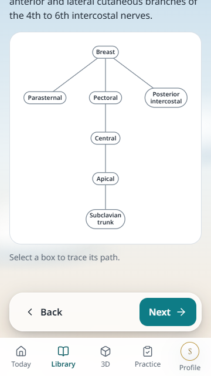
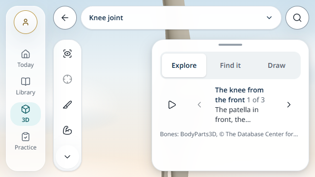
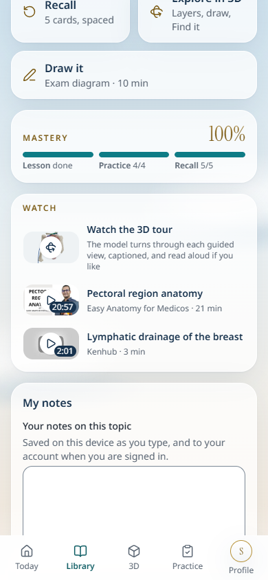
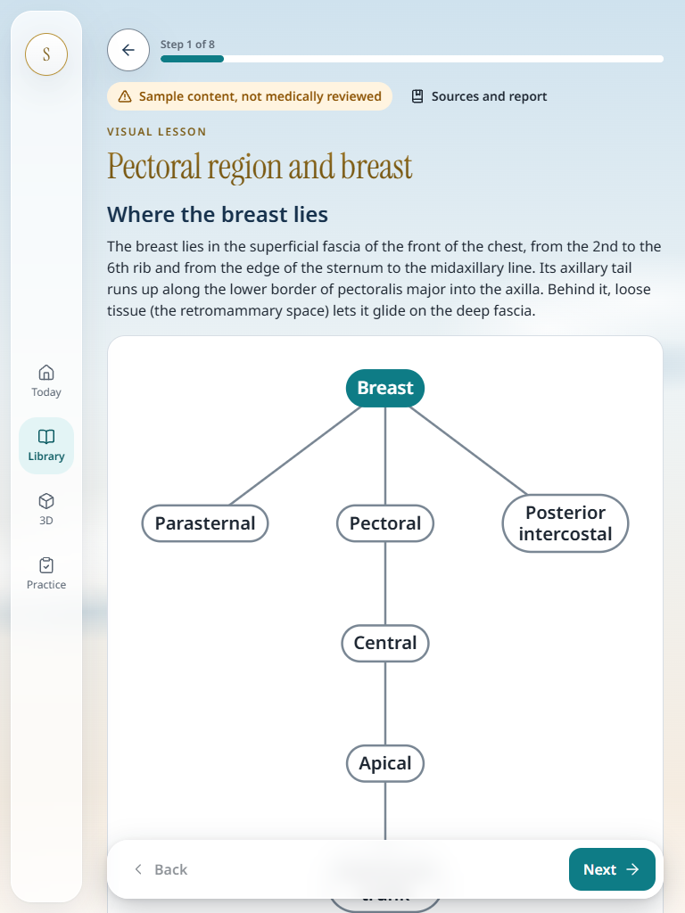
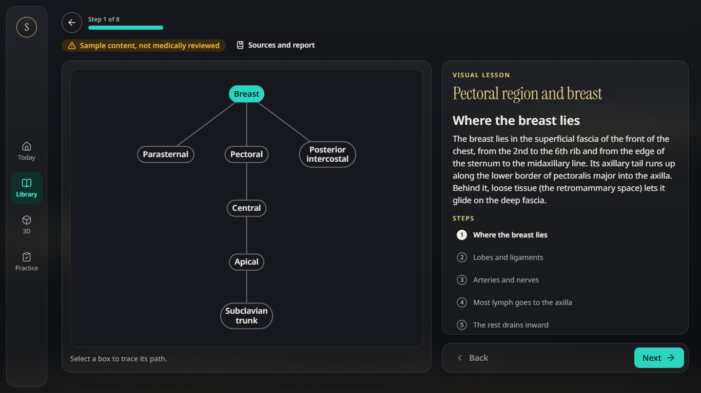

# MedLearn OS: student study journey and responsive design review

17 October 2026. Reviewed revision **`40bfa99ba32a9788186ab28281ef0b51c08387d7`**, `study-journey`, in a separate `codex/study-journey-ui-review` checkout branch. This is a review and recommendation report; application code was not changed.

The current visual direction should stay. The most valuable next work is to make a new teaching step visible, keep the selected anatomy clear of landscape panels, and make progress wording accurately describe the recorded activity. A larger redesign would not address these causes.

## What changed since the previous review

[PR #68](https://github.com/rakshithananda18-cmyk/MedLearn-OS/pull/68) is merged. The latest source work is in [PR #69](https://github.com/rakshithananda18-cmyk/MedLearn-OS/pull/69): the journey diagnosis, `aa5bb50` lesson/progress changes, and `40bfa99` Studio changes. The source checkout matched that revision; its only uncommitted change when inspected was `.claude/launch.json`, which was not copied or modified.

| Previous concern | Current evidence |
| --- | --- |
| Today detours through the topic hub before starting a lesson | Fixed: its primary lesson action opens the lesson directly. |
| Reload resets an unfinished lesson to step one | Fixed on the same browser/device: step 2 of 8 remained step 2 after reload on all five journey layouts. Completion cleared the checkpoint. |
| Completed and interrupted lessons use inconsistent action wording | Shared Start / Continue / Go over wording is implemented. |
| Topic page puts optional videos ahead of studying | Fixed ordering. On the inspected Brachial plexus hub, Start lesson is at y=539–609 on 390×844 and y=470–560 on 360×640. |
| Plan starts with a full completion bar | Fixed: the inspected fresh plan starts at `0 of 15 min done`. Interpretation of the changing total still needs refinement below. |
| Studio overflow is hard to discover | A labelled More tools control already exists; preserve it. |
| Narrow Library titles/actions compete for space | Container-aware wrapping and simpler headings are implemented. The additional 320-pixel/200% text mobile capture widened its layout viewport to 383 pixels; it is not a clean reflow pass and needs the specific follow-up below. |

## Method and boundaries

The primary investigation followed one existing topic, **Pectoral region and breast**: Today → lesson → interruption/reload → completion and check questions → recall/feedback → return. It ran on laptop **1366×768**, tablet portrait **768×1024**, tablet landscape **1024×768**, phone **390×844**, and short phone **360×640**. A follow-up completed the remaining practice questions and rated all five recall cards Again. Focused Studio probes also covered **640×360** and **844×390** phone landscape; enlarged-text Library inspection added **320×640**.

The production build passed, including TypeScript and **431 generated static pages**. The five journey runs completed. Their 48 recorded states had no page-script errors or horizontal page overflow. Eight targeted axe scans covered Today, a lesson and recall across selected layouts and reported no violations. This is not an app-wide accessibility certification.

Evidence includes DOM geometry, focus location, storage snapshots, screenshots, production source and an interaction trace. Final evidence images wait for fonts and finite animations. Earlier capture images can contain an arrival animation or a model still loading; those are not used to infer blank-rendering defects. Browser inspection used local Chrome, touch/viewport emulation, and software WebGL where needed. Physical iPad/iPhone rendering, software keyboards, a full screen-reader journey and performance on student hardware remain unverified.

No students participated in this review. Observed interface behaviour is distinguished below from its hypothesized effect on a learner. There is no measured claim of improved learning or retention.

Raw local evidence and reproduction scripts are retained in `test-results/study-journey-ui-audit/`: `observations.json`, `probes.json`, `boundaries.json`, `evidence.json`, four `.mjs` scripts, PNGs and `all-again-trace.zip`. The scripts require this revision's production build running on localhost:3103 with `ACCESS_OPEN=true`. Account and quota probes use explicitly isolated browser fixtures; they do not change real accounts.

## Three priorities

### 1. Make Next deliver the new explanation

**Priority: P1. Confirmed on the short phone; effect on student comprehension is a hypothesis.**

Reproduction: at 360×640, open the lesson, advance to step 2, reload, scroll to the diagram's bottom and press the floating Next button. The app moves to step 3, but leaves the page at scrollY=418 and keyboard focus on Next. The new **Arteries and nerves** heading is at **y=−170 to −138**, entirely above the viewport. The diagram remains on screen while the teaching explanation changes out of sight. The result persists after the arrival animation finishes.

The source updates the step and checkpoint in `LessonView.tsx:114–117`; it does not focus or reveal the new heading at `:155–157`. Below 1024 pixels, `Flow.tsx:120–138` stacks the explanation above the diagram. The issue is the transition between steps, rather than evidence that the diagram itself is inaccessible. A separate final-scroll probe found the bottom Subclavian lymph trunk label fully uncovered at y=354–392 on the short phone.

**Smallest change:** after an explicit Next/Back step change, reveal and focus the new step heading. On stacked layouts, bring the new explanation into the usable viewport. On wide layouts, move the text pane to its new heading while keeping the diagram stable. Avoid resetting a student's exploration on unrelated rerenders.

**Independent acceptance:** reproduce the action with touch and keyboard. The new heading must be visible above the action bar, receive appropriate focus/announcement, and match the highlighted diagram. A student should be able to explain what changed without scrolling upward to discover an unseen instruction. If observed students consistently follow the transition correctly without assistance, reduce the claimed usability impact; the off-screen geometry remains a technical fact.

### 2. Frame the Studio around the space its panels actually leave

**Priority: P1 for phone landscape. Confirmed occlusion.**

At **640×360**, opening `/studio?topic=knee-joint` places the information sheet across **x=308–628**, while the model remains centred around x=368. The sheet covers the joint that the guided view describes. At **844×390**, it also covers part of the knee. The screenshots contain rendered bones; this is not a conclusion drawn from a blank loading placeholder.

The layout's 96-pixel navigation gutter leaves a 544-pixel Studio at 640-pixel width. `stage.tsx:540` moves the short-screen BottomSheet into an absolutely positioned 320-pixel side panel. `useBottomCover` in `Studio.tsx:925–930` measures its normal-flow wrapper, which has effectively zero height in this arrangement. Phone rendering also defaults `insetRight` to zero at `:1283–1291`. The viewer therefore fits and centres using space occupied by the sheet. This needs actual sheet geometry, not a smaller global model scale.

**Smallest change:** measure the covering panel rectangle relative to the Studio and pass the corresponding right or bottom inset. Recalculate after orientation changes and panel changes. Preserve the useful header/footer framing and docked laptop/tablet composition already added.

**Independent acceptance:** at both landscape sizes, the selected joint and its relevant labels remain visible beside the description through all guided views and after resize. Test the actual projected anatomy and pointer access, as well as DOM panel bounds; an unclipped canvas alone does not prove the anatomy is visible.

A related compact-panel state issue is also confirmed: on 360×640 whole-body Studio, select Upper limb, then open Search. **Topics and Search both remain active at the same x=12, y=80, 320×400 rectangle.** Escape closes Search and reveals Topics. `PhoneOverlay` keeps region Topics in local `regionTopics` state while the other tools use `session.panel` (`Studio.tsx:981–1049`). Coordinate one active floating panel, or deliberately present an explicit Back-to-topics navigation model. Do not leave the closing behaviour implicit. No screen-reader violation is asserted from this observation alone.

### 3. Describe activity and retention accurately

**Priority: P2. Confirmed numerical behaviour; student interpretation needs testing.**

In an actual scripted journey, the lesson was completed, all four practice questions answered correctly, and **all five recall cards rated Again: Forgot**. The topic then displayed:

> Mastery 100% · Lesson done · Practice 4/4 · Recall 5/5

`packages/core/src/mastery.ts:36–50` counts whether a review exists, independently of its rating. `features/progress/MasteryCard.tsx:36–39` calls the result Mastery. Recall scheduling still brings forgotten cards back: this finding concerns what the displayed percentage means, not proof that spaced repetition is broken.

The daily plan also changes its denominator as work is suggested: **0 of 15 → 17 of 34 min done** after the lesson and two check questions. After practice and recall it showed **21.5 of 33.5**, against a 20-minute daily goal. Importantly, the current app also says **Goal met, well done** and **Anything more today is a bonus**; preserve that helpful stopping cue. The remaining issue is the coexistence of a growing plan fraction with a completed daily goal. Activity minutes are estimates credited for completed events (`packages/core/src/activity.ts:5–6,29–30`), rather than elapsed reading time.

**Smallest change:** label the current percentage **Study coverage** or an equivalent description of completed work. Qualify the minutes as estimated activity. Keep the goal separate from suggested next work, for example “About 22 min completed · Daily goal met” and “12 min suggested next.” This can be a copy/hierarchy change without building another learning score or time tracker.

**Independent acceptance:** reproduce the all-Again state and confirm the interface does not label it demonstrated mastery. Ask students, without explaining the intended answer, what the percentage, minutes and goal establish. Record their answers and any requests for clarification. Claims of retention require an appropriate recall assessment; neither completion nor the current percentage establishes retention.

## Colour, hierarchy and device recommendations

Keep the original reference's **sky blue → warm cream**, restrained gold display typography, teal actions, soft surface edges and calm space. The current app already expresses that direction. Retain gold serif for large page/hero headings and sans-serif for teaching prose, compact headings, lists and controls. The recent Library changes move in the right direction.

Use the background scene around the content; give long explanations and diagrams a stable, quiet reading surface. Make nested groups flatter than the main hero rather than adding more glass, clouds or shadows. Avoid letting a decorative model displace the primary lesson action on compact entry screens. Optional book prompts still precede Up Next for a returning student without books selected; test that state before deciding whether to move the prompt below the current task.

The enlarged-text Library probe requested 320×640 but Chrome exposed a 383-pixel layout viewport and scaled the page. Comparing document width with that expanded `innerWidth` would conceal the reflow limitation. Treat this case as unverified: repeat with a fixed 320-CSS-pixel layout viewport and actual browser zoom, record configured width, `clientWidth`, `visualViewport.width` and scale, then check on a physical phone. Preserve the current title/action wrapping while identifying which minimum-width content causes the expansion.

| Device | Preserve | Focus the next change |
| --- | --- | --- |
| Laptop | Rail, useful side-by-side teaching, quiet night theme | Keep explanation/diagram comparison stable while fixing step focus. |
| Tablet landscape | Docked Studio panels and split lesson | Check usable pane widths and panel changes, not just total viewport width. |
| Tablet portrait | Readable text and large diagram | Compact repeated topic context where it helps comparison; keep the new explanation visible after advancing. |
| Phone portrait | Direct lesson entry, teal lesson action, bottom navigation | Fix step-transition focus and keep one clear active floating panel. |
| Phone landscape | Side-positioned description is a useful adaptation | Frame anatomy in the actual uncovered space; current placement hides the joint. |

## Continuity hardening before wider use

The new checkpoints are explicitly **device-only**. Same-device resume is verified; exact laptop-to-phone lesson position is not synced. Describe that boundary accurately rather than claiming cross-device step resume.

Two additional browser probes exposed edge cases:

- **Sign-out cleanup:** with mocked account/sign-out HTTP responses and the real production client cleanup, `ml-progress-v1` cleared its profile but `ml-lesson-steps-v1` retained step 2. A subsequent visitor opened at step 2. Source confirms `AccountView.tsx:59–61` calls progress and Studio cleanup without clearing lesson checkpoints. Clear or account-scope this key. This is a client-boundary test, not a real backend authentication test.
- **Storage quota:** forcing only the checkpoint write to throw `QuotaExceededError` allowed the current lesson to reach step 2, but navigating back to the topic showed Start lesson instead of Continue. `checkpoint.ts:16–24` reloads the old stored value over its failed-write cache. Preserve the same-visit fallback, following the existing progress-store memory-only pattern. Storage that cannot be written cannot provide durable reload recovery; that is separate from losing the in-memory fallback.

The checkpoint's server snapshot also allocates a new empty object (`checkpoint.ts:72`). An isolated development hydration probe emitted React's cached-snapshot warning. No production infinite loop was established; use a stable empty snapshot as a small implementation correction.

## Current CI and an independent student check

At this review's final check, [PR #69's run 38976001954](https://github.com/rakshithananda18-cmyk/MedLearn-OS/actions/runs/38976001954) has **five passing checks and one failing phone check**. Desktop/tablet journeys, code checks, database/integration and Sonar pass. The phone suite has 40 passing tests; one fails before its practice/offline assertions because `navigator.serviceWorker.ready` resolves but the page never acquires a controller during the five-second poll. Mobile performance budgets are not reached in that job. The all-green result previously reported belongs to PR #68, not this revision.

All three failing traces were inspected. `/offline` returns 200; both retry traces show `/sw.js` returning 200. The landing-to-Today navigation starts roughly 33–48 ms after landing load and overlaps worker installation. This supports a navigation/activation/claim race hypothesis, but worker lifecycle events were not recorded, so the cause remains unresolved. The worker, registration component and test helper have not changed since the merged baseline. Instrument those events in a matching phone reproduction before changing the timeout or calling this an offline-feature regression. The downloaded report is retained under the raw evidence folder's `ci-phone-report/`.

For an independent usability check, run a small formative round with representative medical students using their own usual laptop, tablet or phone. Use the same topic and neutral tasks: start the planned study; explain a named structure using the diagram; leave and return; interpret the progress display. Record unassisted completion, assistance, wrong turns, missed explanations and progress interpretation. Compare one focused candidate change with the current build using consistent tasks and varied presentation order. Report raw counts and limitations; a small formative round does not establish a population-wide improvement.

Use [GDS's moderated-testing guidance](https://www.gov.uk/service-manual/user-research/using-moderated-usability-testing) for neutral task design, and [WCAG reflow](https://www.w3.org/WAI/WCAG22/Understanding/reflow.html) and [focus-not-obscured](https://www.w3.org/WAI/WCAG22/Understanding/focus-not-obscured-minimum.html) as relevant independent accessibility checks. The off-screen lesson explanation is a usability observation; it is not automatically a violation of focus-not-obscured, which concerns focused components.

The recommended implementation order is: **lesson transition → landscape framing → progress wording**, then panel/checkpoint hardening. Resolve the phone CI setup failure before merging. Keep the existing visual identity and validate these specific changes before expanding the design work.
