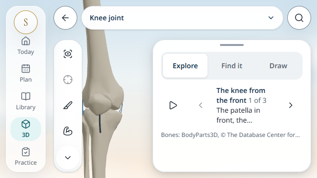
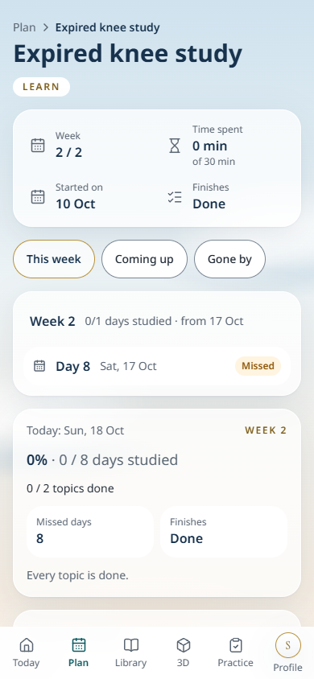
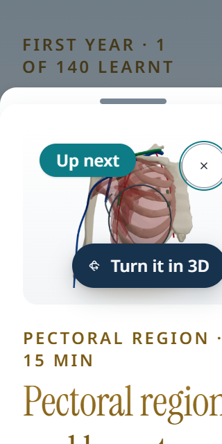

# MedLearn OS: student UI/UX review

18 October 2026. Baseline: `codex/knee-atlas-sample`, merge `339bdc7`, with source `ae91f16` and its uncommitted planner changes copied into this checkout. Robocopy copied 322 files with zero failures; 877 source-file hashes matched. Work and review stayed in `MedLearn-OS-Codex`; the source folder was not changed.

Keep the sky-to-cream background, restrained gold headings, teal actions and quiet reading surfaces. The useful next work is clearer plan outcomes, consistent task destinations and compact-screen composition. A whole-app visual redesign is unnecessary.

## Evidence and boundaries

The current production browser review covers 41 captured states across laptop, tablet and phone, with additional short-phone, landscape and enlarged-text checks. The local database was unavailable, so this visual review used the app's bundled-subject fallback on a separate server and isolated student profiles. There were no page-script errors; four targeted axe scans reported no violations. These are scoped checks, not complete accessibility or student validation. Build/TypeScript, full lint and 75 focused tests across five files passed. No actual AI request was sent. Physical devices, software keyboards, backend authentication and a full assistive-technology journey remain unverified.

Current evidence is in `test-results/ui-ux-review-2026-10-18/current/results.json` and adjacent PNGs. The older `observations.json` records revision `1df841e`; it must not be used to describe the copied app as unchanged.

## Improvements to preserve

The earlier lesson-transition defect is fixed: on the short phone the new **Arteries and nerves** heading is visible at y=8 and receives focus. Source now explicitly reveals it (`LessonView.tsx:107–117`). Studio measures the actual covering sheet and supplies the right/bottom inset; opening another tool closes region Topics (`Studio.tsx:920–959,1004–1008`). Checkpoint storage fallback, stable server snapshot and sign-out cleanup are implemented.

The topic now says **Study coverage**, recall cards are **seen**, and Today separates estimated activity, its daily goal and suggested work. Retire the earlier misleading Mastery and moving-total recommendations. Preserve direct lesson entry, shared Start/Continue/Go over wording, study actions before optional videos, and the helpful daily stopping cue.

## Priorities

### 1. Make plan outcomes truthful and actionable

**Observed:** an expired plan displays **0 / 2 topics done**, **Every topic is done**, and **Finishes: Done** together. This can tell a student their unfinished revision is complete. Core logic already distinguishes `ended` from `completed` (`packages/core/src/plans.ts:132–141`); `PlanCalendar.tsx:189,394,405` treats an absent future schedule as completion. Show **Deadline passed · 2 topics left**, followed by Extend date or Reschedule. Separate ended and completed states under the current Finished tab (`PlanView.tsx:38–39,136`). Verify completed, expired-incomplete, future-start and rest-day plans independently.

**Observed in all three main layouts:** calendar topic links open `/learn/[slug]` (`PlanCalendar.tsx:342`), while Continue opens the lesson for a learn plan or goal-specific practice for a test/revisit (`plan/words.ts:48–51`). Keep the topic name as an explicit overview link, and add a clearly named **Start lesson / Practise this topic** action that preserves the plan ID. A calendar should make the scheduled task predictable.

On the captured phone calendar, Continue is around y=1131, below the statistics and calendar. Put the next task before those details on compact layouts.

### 2. Match planning promises to saved schedules

**Source-confirmed:** AI details suggest **weekends off** (`AiPlan.tsx:213`), but the proposal schema and acceptance path cannot retain study weekdays or days off (`packages/schemas/src/plan.ts:28–37`; `AiPlan.tsx:110–119`). Carry these choices through generation, preview and saved goals, or remove unsupported examples and explain the manual calendar adjustment. This finding concerns the contract; no live model response was tested.

Calendar **Time spent** is a sum of completed topics' estimated durations, not elapsed study time (`PlanCalendar.tsx:181`; `plans.ts:131–139`). Rename it **Estimated work completed**, consistent with Today's improved wording.

**Source-supported enhancement:** the new plan wizard changes steps without moving focus (`PlanBuilder.tsx:339–346`). The tested default transition shows When at y=157 with scrollY=0, so a hidden-heading failure is not established; focus falls back to the body. Apply the lesson's deliberate heading-focus pattern and test a long topic selection with keyboard and touch.

### 3. Make search easier to scan

The phone's knee results mix topic names, structures and long fact excerpts. The full results page uses the excerpt as the main title and puts topic context underneath (`app/(study)/search/page.tsx:70–75`). Live suggestions already group topics and structures and give topic titles priority (`LiveSearch.tsx:61–87`); carry that clarity into the full results page. Use a stable topic/structure title first, a small content-type label, then a short highlighted excerpt. Preserve fuzzy matching. Test finding a named joint and a clinical fact without reading every card.

### 4. Complete compact-screen checks before wider rollout

**Observed:** enlarged-text Library has client/visual width 320, scale 1, and document width 383. Horizontal overflow is reproducible with the current valid book fixture. Check individually nonshrinking subject chips (`Library.tsx:72`) and narrow card constraints; wrapping the outer row alone is insufficient. Fix this specific case and repeat actual browser zoom and physical-phone checks; this is not a claim of app-wide WCAG failure.

The knee sample remains a review-only direction. At 390×844, Recall arrives with the model canvas at y=38–378, but its two answers start at y=864 and 922. Put the choices directly below the model and move repeated explanation into supporting text. The diagram's 12-pixel SVG labels scale to about 6 rendered pixels on this phone; show a simpler current-step diagram at a legible size. Keep the existing mobile task cue, reset, names, bone context and awaiting-anatomy-review status. Add an orientation cue before wider use: the selected preset button records the last preset, rather than tracking subsequent manual rotation.

Phone navigation now has six items including Profile (`AppNav.tsx:13–24,82–91`). Test short widths, enlarged text and one-handed use before deciding whether Profile belongs in a header. Keep laptop/tablet rails and avoid hiding core study routes behind unexplained icons.

Keep the sky scene around content, with stable near-white study surfaces, serif/gold page titles and sans-serif instructional text. Make the large recall hero more compact where it contains little content. Companion candidates remain on the design page; an optional, quiet presentation should be tested before they enter study screens.

Implementation order: truthful plan states and destinations, supported scheduling choices, compact reflow, then search and sample proportions. Validate these changes with medical students using neutral tasks on their own usual devices; record wrong turns, missed instructions and interpretation of progress rather than assuming learning improvement. Use [GDS moderated-testing guidance](https://www.gov.uk/service-manual/user-research/using-moderated-usability-testing) for task design and [WCAG reflow guidance](https://www.w3.org/WAI/WCAG22/Understanding/reflow.html) for the enlarged-content follow-up.
